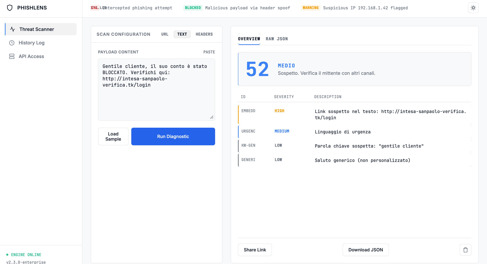

# PhishLens

Engine di threat intelligence client-side progettato per il rilevamento di tentativi di phishing, typosquatting e spoofing, sviluppato con un focus assoluto su privacy e performance.

---

## Preview



---

## Panoramica

PhishLens esegue l'intera analisi direttamente nel browser, garantendo che nessun dato lasci il dispositivo dell'utente. Il sistema non effettua chiamate API esterne, non include tracciamenti e azzera le dipendenze esterne. Combina analisi euristica e una moderna dashboard di tipo SOC (Security Operations Center) per fornire report di rischio immediati e azionabili.

---

## Funzionalità Principali

- **URL Analyzer:** Rilevamento di typosquatting (distanza di Levenshtein), host IP, domini punycode, TLD sospetti, URL shortener ed estensioni eseguibili.
- **Text Payload Analyzer:** Scansione di email e SMS per parole chiave di urgenza, richieste di credenziali, IBAN, carte di credito e wallet crypto, con analisi ricorsiva dei link incorporati.
- **Email Header Analyzer:** Validazione SPF, DKIM, DMARC, identificazione di disallineamenti From/Reply-To e rilevamento di Display Name spoofing.
- **Enterprise Dashboard:** Interfaccia grafica con supporto ai temi scuro/chiaro, stati di caricamento skeleton e cronologia locale delle scansioni.
- **Raw JSON Export:** Visualizzazione ed esportazione di report dettagliati in formato JSON per l'integrazione con sistemi SIEM.
- **PWA Ready:** Installabile come applicazione desktop/mobile e pienamente utilizzabile offline tramite Service Workers.
- **Anti-Crash Protection:** Limiti di dimensione del payload per prevenire blocchi del browser su input massivi.

---

## Sistema di Punteggio

Ogni indicatore di rischio possiede un peso e una severità specifici. La somma dei pesi genera un punteggio complessivo da 0 a 100:

| Punteggio | Classificazione | Azione Consigliata |
| :--- | :--- | :--- |
| **80 - 100** | `CRITICAL` | Minaccia confermata. Non interagire. |
| **60 - 79** | `HIGH` | Fortemente sospetto. Verificare il mittente. |
| **40 - 59** | `MEDIUM` | Segnali anomali. Procedere con cautela. |
| **20 - 39** | `LOW` | Rischio basso, ma da monitorare. |
| **0 - 19** | `SAFE` | Nessun indicatore critico rilevato. |

---

## Stack Tecnologico

- **HTML5:** Struttura semantica
- **CSS3:** Grid, Flexbox, Custom Properties, Skeleton Loading
- **JavaScript:** Moduli ES6+ nativi, Service Workers, LocalStorage, Clipboard API

---

## Installazione e Utilizzo

Nessun passaggio di build richiesto.

1. Clonare il repository:
   ```bash
   git clone [https://github.com/nowii-core/phishlens.git](https://github.com/nowii-core/phishlens.git)

No build step required.

1. Clone the repository:
   ```bash
   git clone https://github.com/nowii-core/phishlens.git


GitHub: @nowii-core
